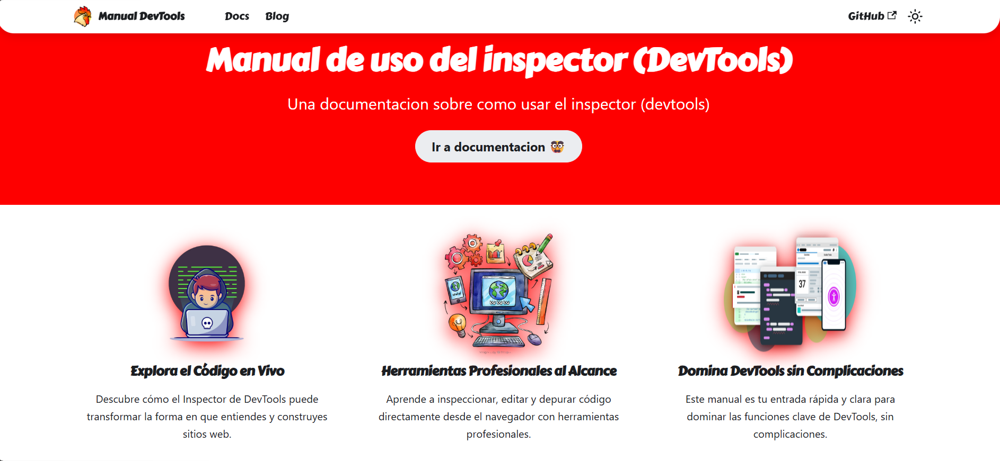

<h1 align="center">🛠️ Manual DevTools</h1>

<p align="center">
<strong>Domina las herramientas de desarrollo de Chrome y lleva tus habilidades web al siguiente nivel.</strong>
</p>

<p align="center">
Un manual educativo e interactivo para aprender a inspeccionar interfaces, depurar código, analizar el rendimiento y optimizar aplicaciones web.
</p>
<p align="center">
<a href="https://manual-devtools.vercel.app/">

</a>
</p>
<p align="center">


</p>

📸 Vista previa

<p align="center">
<a href="https://manual-devtools.vercel.app/">

</a>
</p>

## 📚 ¿Qué encontrarás en este manual?

Una guía completa para conocer y aprovechar las principales herramientas de desarrollo del navegador.

| Sección           | Contenido                                    |
| ----------------- | -------------------------------------------- |
| Introducción      | Fundamentos y funcionamiento de DevTools     |
| Elements          | Inspección del DOM y modificación de estilos |
| Console & Sources | Depuración y análisis de código              |
| Debugging         | Breakpoints, watchers y snippets             |
| Network           | Análisis de solicitudes y respuestas HTTP    |
| Application       | Cookies, caché e IndexedDB                   |
| Performance       | Grabaciones y análisis del rendimiento       |
| Lighthouse        | Auditorías y optimización web                |
| Device Mode       | Simulación móvil y limitaciones de red       |
| Personalización   | Atajos de teclado y configuración            |
| Seguridad         | Buenas prácticas de seguridad web            |
| Consejos          | Trucos, recomendaciones y casos de uso       |

---

## ⚙️ Tecnologías utilizadas

Este proyecto está construido con herramientas modernas del ecosistema de desarrollo web.

<p align="center">

</p>

| Tecnología                               | Descripción                         |
| ---------------------------------------- | ----------------------------------- |
| [Docusaurus 3.7](https://docusaurus.io/) | Framework de documentación          |
| React 19                                 | Biblioteca para interfaces          |
| MDX                                      | Documentación con componentes React |
| React Icons                              | Biblioteca de iconos                |
| JavaScript                               | Lenguaje de programación            |
| CSS Modules                              | Estilos encapsulados                |

---

## 💻 Requisitos previos

Antes de comenzar, asegúrate de tener instalado:

- **Node.js:** versión 18 o superior.
- **npm:** gestor de paquetes de Node.js.
- **Git:** para clonar el repositorio.

---

## 🚀 Instalación y configuración

Sigue estos pasos para ejecutar el proyecto en tu entorno local.

### 1\. Clonar el repositorio

bash

```bash
git clone https://github.com/YordyHc/docusaurio_yor.git
```

### 2\. Acceder al directorio

bash

```bash
cd docusaurio_yor
```

### 3\. Instalar dependencias

bash

```bash
npm install
```

### 4\. Iniciar el servidor de desarrollo

bash

```bash
npm start
```

Una vez iniciado, abre tu navegador en:

text

```text
http://localhost:3000
```

---

## 📦 Construcción y despliegue

Para generar una versión optimizada para producción:

bash

```bash
npm run build
```

Para visualizar localmente la versión compilada:

bash

```bash
npm run serve
```

Los archivos generados se almacenarán en la carpeta `build/`.

---

## 🧰 Comandos disponibles

| Comando           | Función                               |
| ----------------- | ------------------------------------- |
| `npm start`       | Inicia el servidor de desarrollo      |
| `npm run build`   | Genera la versión de producción       |
| `npm run serve`   | Previsualiza el sitio compilado       |
| `npm run clear`   | Limpia la caché de Docusaurus         |
| `npm run swizzle` | Personaliza componentes de Docusaurus |
| `npm run deploy`  | Ejecuta el despliegue configurado     |

---

## 📁 Estructura del proyecto

text

```text
docusaurio_yor/
│
├── blog/                      # Entradas y autores del blog
│
├── docs/                      # Documentación principal
│
├── src/
│   ├── components/            # Componentes reutilizables
│   ├── css/                   # Estilos globales
│   ├── pages/                 # Páginas personalizadas
│   └── theme/                 # Personalización del tema
│
├── static/
│   ├── img/                   # Imágenes públicas
│   └── imagenes_ignore/       # Recursos adicionales
│
├── docusaurus.config.js       # Configuración del sitio
├── sidebars.js                # Configuración del menú lateral
├── package.json               # Dependencias y scripts
└── README.md                  # Documentación del proyecto
```

---

## 🤝 Contribuciones

¡Las contribuciones son bienvenidas\! Si deseas mejorar el contenido, corregir errores o agregar nuevas funcionalidades, puedes colaborar siguiendo estos pasos:

**1.** Haz un fork del repositorio.

**2.** Crea una rama para tus cambios:

bash

```bash
git checkout -b mejora/documentacion
```

**3.** Realiza tus modificaciones y verifica que el proyecto funcione correctamente:

bash

```bash
npm run build
```

**4.** Crea un commit descriptivo:

bash

```bash
git add .
git commit -m "docs: mejorar documentación"
```

**5.** Envía tus cambios y abre un Pull Request.

> 💡 Antes de contribuir, revisa la ortografía, el formato de las imágenes y el funcionamiento de los enlaces.

---

## 🌐 Acceso al proyecto

<p align="center">
<a href="https://manual-devtools.vercel.app/">

</a>
</p>

<p align="center">
📖 Aprende · 🔍 Explora · 🛠️ Experimenta · 🚀 Optimiza
</p>

---

<p align="center">
<strong>Manual DevTools</strong>
</p>
